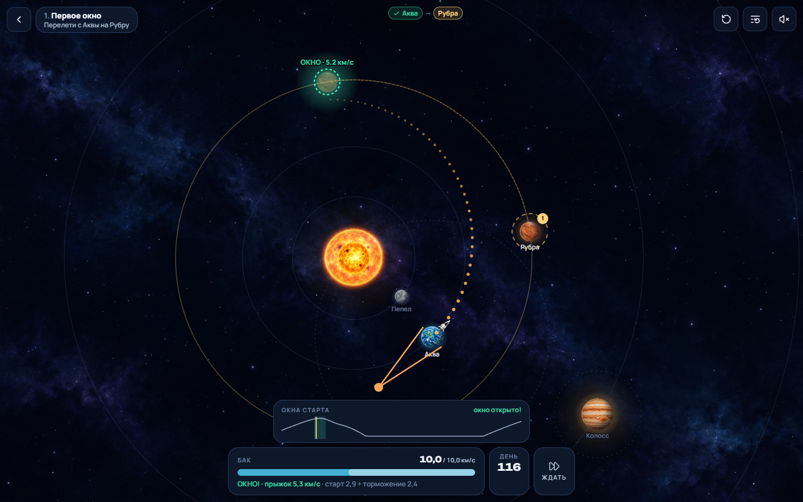
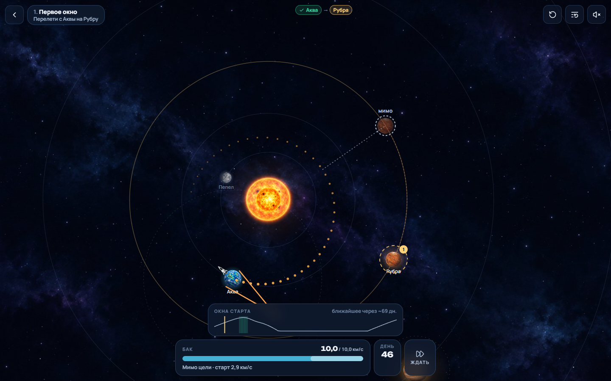
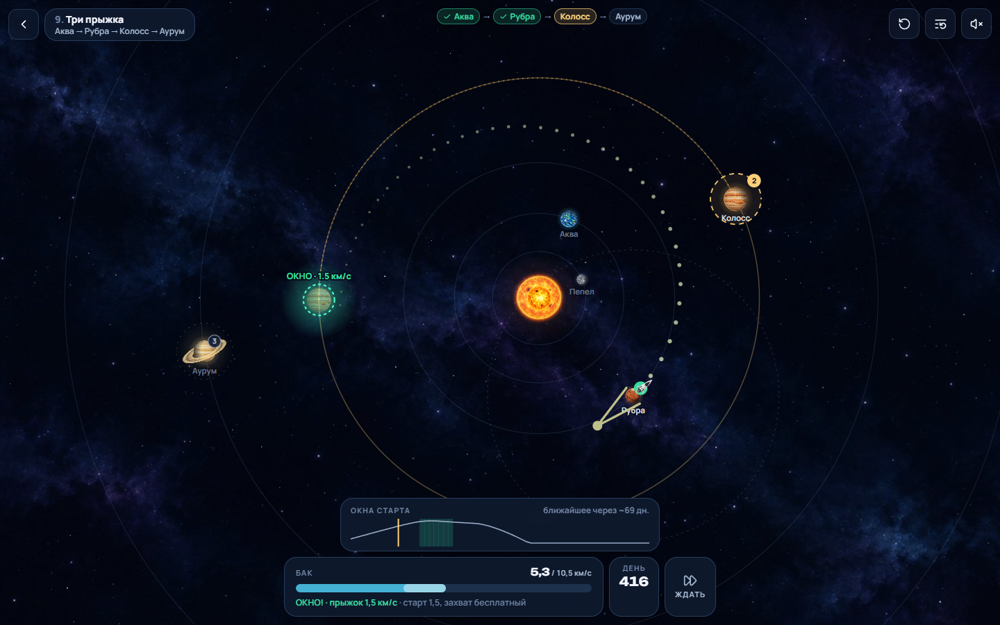
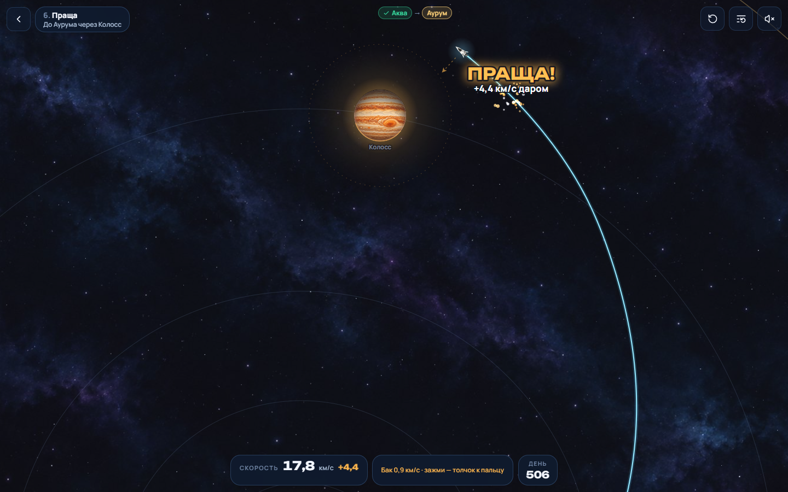
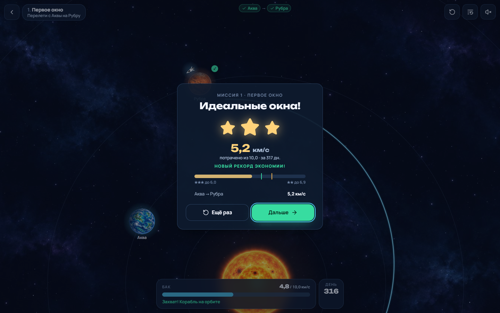
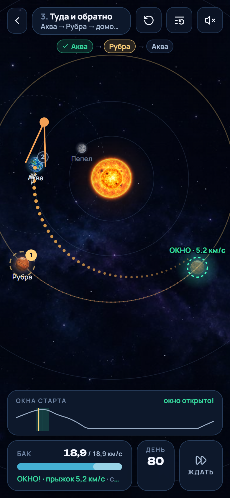

# SLINGSHOT — окна старта

**Прыгай с планеты на планету на одном баке. Планеты не ждут: лови окно старта.**

Это ветка `orbits`. Миссия — цепочка межпланетных прыжков (Аква → Рубра → Колосс → …). Корабль стоит на орбите у
планеты, время идёт, планеты движутся, и цена каждого прыжка зависит от момента старта: в окно он дешёвый, в остальное
время — дорогой или мимо. Топливо общее на всю миссию; гиганты по пути разгоняют бесплатно. Физика честная — тот же
интегратор, что в классической версии.

Другие ветки: `master` — классический планировщик манёвров, `casual` — бросок рогаткой без окон.

| Окно открыто | Рано: мимо | Второй прыжок из трёх |
| --- | --- | --- |
|  |  |  |

| Праща в пути | Результат | Телефон |
| --- | --- | --- |
|  |  |  |

## Запуск

```bash
npm install
npm run dev        # http://localhost:5173
npm run build      # типы + production-сборка в dist/
npm test           # физика, миссии, окна, бак, чекпоинты, ускорители, прогресс (Vitest)
npm run e2e        # сквозные сценарии в браузере (Playwright, десктоп + телефон)
npm run levels     # пересобрать миссии (tools/mission-build.ts, ~6 минут)
```

`npm run e2e` по умолчанию запускает системный Microsoft Edge (`channel: 'msedge'`); другой канал задаётся через
`PW_CHANNEL` (например, `PW_CHANNEL=chrome`). Нужен Node 20+. Прогресс хранится в `localStorage` (ключ
`slingshot:orbits`). Адрес с `?all` открывает все миссии.

## Как играть

1. **Жди окна.** График «Окна старта» показывает цену прыжка по дням: пики — окна, жёлтая черта — сейчас. Держи
   «Ждать ⏩» (или F), чтобы время бежало в шесть раз быстрее.
2. **Целься.** Потяни резинку от планеты — время замедлится. Точки показывают весь прыжок, полупрозрачная копия цели
   — где она будет, когда корабль подлетит. **Зелёная копия — окно**: прыжок не дороже лучшего плана +10 %.
   Янтарная — терпимо, красная — дорого или не хватит топлива, серая с пунктиром — мимо. Бак показывает, сколько съест
   прыжок: старт + торможение.
3. **Отпускай.** В полёте можно зажать палец: время замедлится, и толчок в сторону пальца поправит курс (за счёт бака).
4. **Захват.** Подлетел не быстрее второй космической у зоны цели — планета поймает сама. Быстрее — тормозишь
   из бака. Не хватило — прыжок повторяется с той же стоянки и тем же топливом.

Звёзды — за экономию: ★★★ — общий расход не больше эталона +8 %, ★★ — не больше +25 % (на тесном баке пороги
ужимаются), ★ — долетел. В поздних миссиях есть срок: опоздал — миссия с начала.

Клавиатура: `←`/`→` — направление, `↑`/`↓` — сила (с `Shift` — шагом крупнее), `Пробел` — бросок, держать `F` —
ждать быстрее; в полёте держать `Пробел` — ускоритель по курсу, `←`/`→` поворачивают толчок. `R` — прыжок заново,
`Esc` — к миссиям.

## Миссии

| # | миссия | маршрут | эталон, км/с | бак, км/с | срок |
| --- | --- | --- | --- | --- | --- |
| 1 | Первое окно | Аква → Рубра | 5,5 | 10,0 | — |
| 2 | Вниз, к Пеплу | Аква → Пепел | 11,9 | 20,2 | — |
| 3 | Туда и обратно | Аква → Рубра → Аква | 12,2 | 18,9 | — |
| 4 | Лестница | Пепел → Аква → Рубра | 15,5 | 22,5 | — |
| 5 | К Колоссу | Аква → Колосс | 5,0 | 7,0 | — |
| 6 | Праща | Аква → Аурум (через Колосс) | 6,2 | 7,1 | — |
| 7 | Обратный ход | Аква → Колосс → Рубра | 9,3 | 12,6 | — |
| 8 | Сквозь пояс | Аква → Колосс | 5,0 | 6,8 | — |
| 9 | Три прыжка | Аква → Рубра → Колосс → Аурум | 8,1 | 10,5 | — |
| 10 | К Борею | Аква → Колосс → Борей | 8,1 | 10,6 | 2356 дн. |
| 11 | Домой с гиганта | Аква → Колосс → Аква | 14,7 | 19,1 | 1610 дн. |
| 12 | Гранд-тур | Аква → Колосс → Аурум → Борей → Виола | 7,3 | 9,2 | 10100 дн. |

Эталон — лучший план, который нашёл сборщик; бак и пороги звёзд считаются от него. В «Праще» прямой перелёт стоит
около 10 км/с при баке 7,1, так что без пролёта у Колосса не обойтись.

### Как собираются миссии

`tools/mission-build.ts` для каждого прыжка по порядку:

1. ставит планету-цель так, чтобы окно открылось через заданное время после прилёта; в прыжке с пращой пролетает
   бросок конструктора и ставит гиганта, а за ним цель, прямо на путь;
2. ищет окно: porkchop-диаграмма по задаче Ламберта вокруг звезды (`src/game/physics/lambert.ts`), затем уточнение
   настоящим интегратором (планеты тянут) методом Нелдера — Мида по (ожидание, Δv). Эталон целится во внутренние
   60 % кольца цели, чтобы небольшой промах в игре всё равно долетал. Полёт ограничен 1,35 гомановского времени, иначе
   оптимизатор находит многолетние «дрейфы»;
3. планирует всё заново в полностью собранной системе (поздние планеты тянут и ранние прыжки), прокладывает просвет
   в поясе астероидов там, где эталон его пересекает;
4. **проходит эталон в самой игре** (`Session`, 60 кадров в секунду) и только по фактическому расходу задаёт бак,
   звёзды и срок, после чего проходит ещё раз.

Если хоть одна миссия не собирается, файл не перезаписывается. Тот же проход эталона повторяет `tests/missions.test.ts`.

## Физика и правила

Безразмерные единицы с `G = 1`: длина L₀ = 1,5·10⁸ км, масса звезды μ★ = 1, время T₀ ≈ 58,4 суток, скорость
V₀ ≈ 29,7 км/с (`src/game/physics/units.ts`). Планеты — на кеплеровых орбитах. Корабль — пробная частица:
`dv/dt = −Σ μᵢ (r − rᵢ(t)) / |r − rᵢ(t)|³`. Интегратор — Дорман–Принс RK5(4) с `rtol = 1e-10`; шаг не больше
0,08 T₀ и не больше 20 % расстояния до любого тела; события (столкновение, цель, вход и выход из сферы действия)
ищутся внутри шага. Ускоритель — мгновенный импульс, полёт пересчитывается с момента толчка; одинаковые действия дают
побитово одинаковый полёт.

* **Стоянка.** Корабль на свободной орбите у планеты: старт стоит ровно силу броска, а планета отправления в этом
  прыжке не притягивает. Пока корабль в её радиусе отлёта, она его и не останавливает; после выхода снова
  становится твёрдой.
* **Захват**: `max(0, v_отн − √(2μ/r_зоны))` — превышение второй космической на краю зоны цели. Гиганты ловят
  бесплатно, маленьким планетам нужен тормоз.
* **Праща** считается по изменению гелиоцентрической энергии за пролёт без учёта энергии двигателя. Толчок
  внутри сферы — двигатель, а не подарок планеты; ближайшее сближение берётся только по реально пролетённому пути.
* **Гиганты** легче, чем в `casual` (Колосс μ = 0,004). Тяжёлый гигант притягивает корабль издалека и делает любой
  прыжок рядом почти бесплатным, а с ним пропадают и окна. Это видно в истории ветки: первая сборка давала прыжки
  к гигантам за 0,3 км/с.

## Архитектура

```
src/
  game/
    physics/           единицы, орбиты, Дорман–Принс, пропагатор с событиями, интерполяция, задача Ламберта
    levels/            каталог тел системы Лира, падежи названий
    casual/
      types, levels    формат миссии и 12 сгенерированных миссий
      world, sim       физическая система миссии; прыжок с чекпоинтами между толчками, захват, пролёты
      session          миссия в игре: часы стоянки, окна, прогноз, полёт, захват, бак, срок, чекпоинты, события
      scoring, progress звёзды и сохранение
      audio            звуки, синтезированные WebAudio, вибрация на телефонах
      render/          Canvas 2D: копии планет в момент встречи, вердикт окна, маршрут, резинка, частицы, надписи
  state/casualStore    Zustand: экран, HUD, график окон, результат
  ui/casual/           Stage (холст, цикл кадра, жесты, автопилот демо), меню, HUD, карточка результата
tests/                 Vitest
e2e/                   Playwright
tools/                 сборщик миссий, скриншоты, обработка графики
```

## Тесты

`npm test` — 41 тест:

* физика из `master`;
* каждая из 12 миссий проходится эталоном в игре на три звезды, с захватом на каждом прыжке и в срок;
* **окна существуют**: тот же бросок (в системе планеты) на четверть синодического периода позже дороже на 30 %
  и больше или промахивается; график окон проседает там, где стартует эталон;
* часы: при натянутой резинке медленнее, на «Ждать» — быстрее;
* бак: старт и торможение списываются, гиганты ловят бесплатно, бросок не больше остатка, «не хватило на захват»;
* чекпоинты: провал возвращает к стоянке с тем же топливом, опоздание к сроку — к началу миссии;
* ускорители: минимальный и полный заряд, детерминизм, не меняют прошлое, не считаются гравитацией, правила
  отлёта;
* прогресс: миссии по порядку, главы по звёздам, лучший расход.

`npm run e2e` — на десктопе и телефоне: настоящим жестом мыши пройти первую миссию в окно и перейти ко второй
(прогресс переживает перезагрузку); бак оценивает бросок, короткое касание не запускает, «Ждать» ускоряет время;
плохой бросок объясняется, и прыжок начинается заново с полным баком; бросок с клавиатуры; звук.
