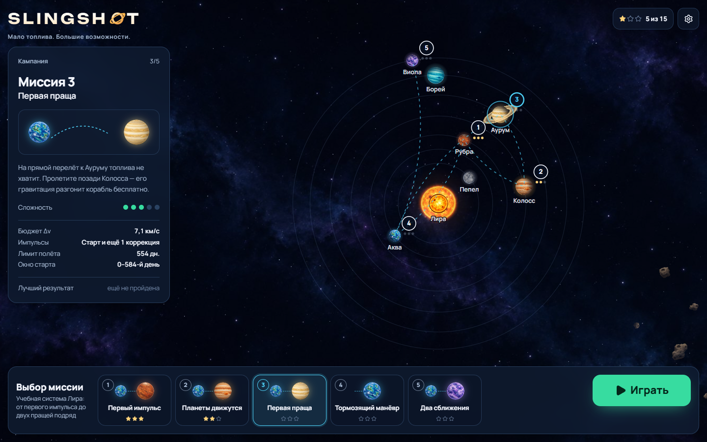
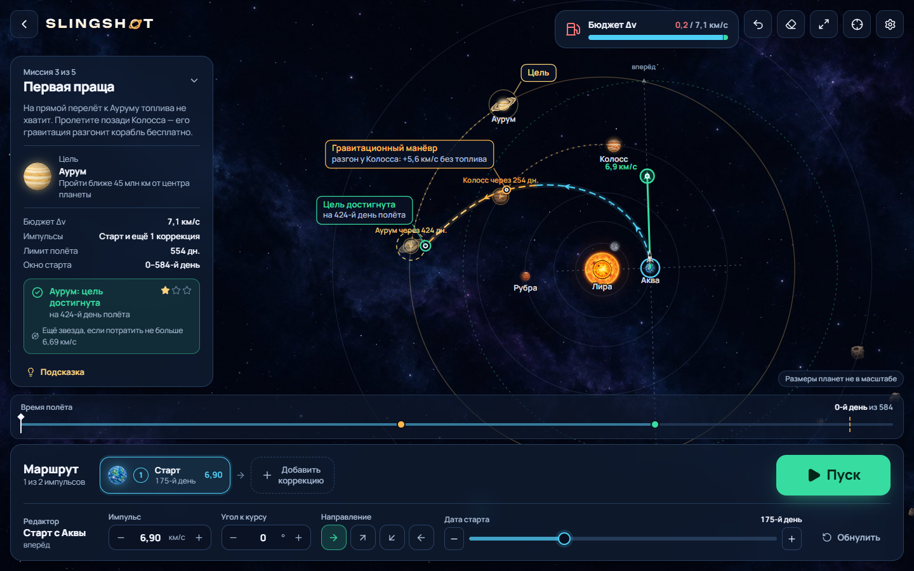
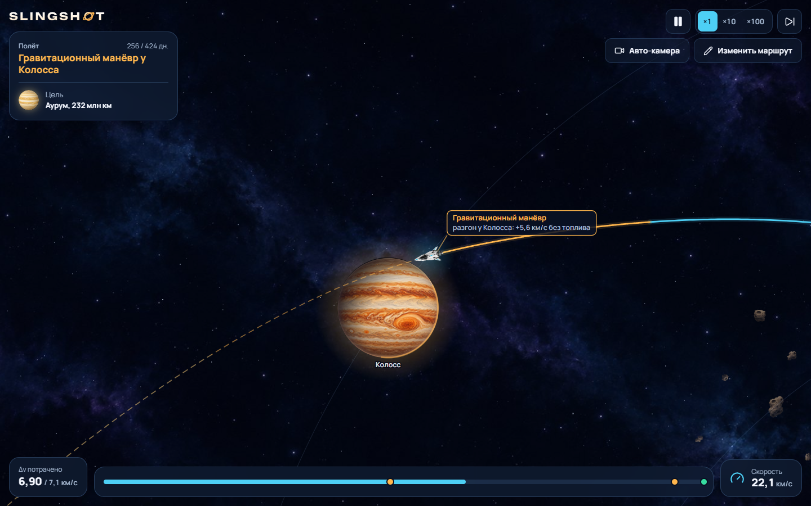
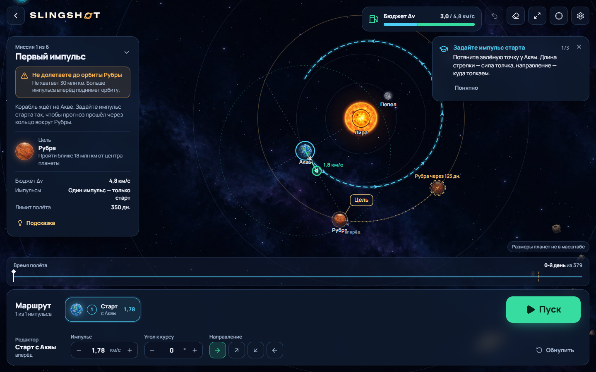
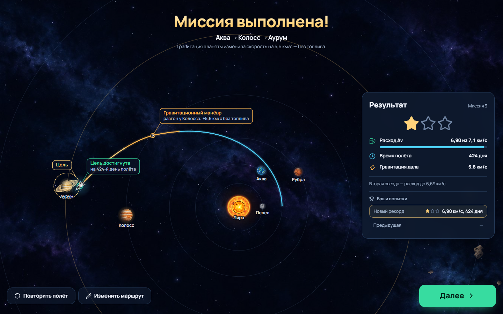
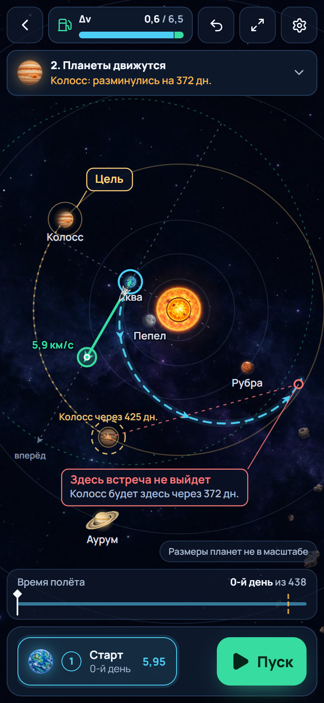

# SLINGSHOT

**Мало топлива. Большие возможности.**

Браузерная головоломка об орбитальной механике. У корабля есть ограниченный бюджет Δv — скорость, которую может
дать двигатель. Игрок выбирает момент старта и ставит импульсные манёвры, а гравитация движущихся планет делает
остальное: пролёт позади планеты разгоняет корабль относительно звезды, пролёт перед ней — тормозит. Топливо на это
не тратится.

Всё, что видно на карте, посчитано численным интегрированием. Игрок не рисует путь — только задаёт физически
допустимые параметры: дату старта, величину и направление импульсов.

| Выбор миссии | Планирование с пращой | Полёт |
| --- | --- | --- |
|  |  |  |

| Промах с подсказкой | Результат | Телефон |
| --- | --- | --- |
|  |  |  |

## Запуск

```bash
npm install
npm run dev        # http://localhost:5173
npm run build      # типы + production-сборка в dist/
npm test           # физика, уровни, правила, клиент Worker'а (Vitest)
npm run e2e        # сквозные сценарии в браузере (Playwright, десктоп + телефон)
```

`npm run e2e` по умолчанию запускает системный Microsoft Edge (`channel: 'msedge'`), чтобы не скачивать браузер;
другой канал — через переменную `PW_CHANNEL` (например, `PW_CHANNEL=chrome`).

Требуется Node 20+. Бэкенда нет, прогресс и настройки хранятся в `localStorage` (ключ `slingshot:save`, схема
версионируется в `src/state/persistence.ts`).

* CI (`.github/workflows/ci.yml`) на каждый push: типы, модульные тесты, сборка и E2E в Chrome.
* Публикация на GitHub Pages (`.github/workflows/pages.yml`): включите в настройках репозитория
  Pages → Source: GitHub Actions; сборка учитывает путь `/<имя репозитория>/` через `BASE_PATH`.
* Скриншоты в `docs/screenshots` снимает `tools/screenshots.ts` (нужен запущенный `npx vite --port 5318`).

## Как играть

При первом входе в миссию запускается **обучение**: затемняет всё, кроме нужного элемента, показывает жест
(«тяните сюда»), и шаг засчитывается, только когда игрок сделал это сам. Кнопка **«?»** открывает шпаргалку по
управлению и позволяет пройти обучение заново.

1. **Выбор миссии** — карта кампании «Учебная система Лира»: 5 миссий и бонусная 6-я; пройденная миссия открывает
   следующую (в настройках можно открыть все сразу).
2. **Планирование** — тяните зелёную ручку импульса у корабля (длина — сила, направление — куда толкаем) или
   задайте числа в редакторе внизу. Пунктир — честный прогноз. Нажмите на пунктир, чтобы поставить коррекцию на это
   время. Шкала «Время полёта» показывает, где будут планеты и корабль в любой момент; полупрозрачная планета —
   её положение в момент встречи. Прогноз пересчитывается непрерывно, пока вы тянете стрелку.
   **Гравитация видна:** бледная линия «так было бы без Колосса» — тот же полёт без притяжения планеты-пращи,
   пунктирный круг у гиганта — зона, где он заметно тянет.
3. **Пуск** — анимация того же рассчитанного пути: пауза, ×1/×10/×100, переход к следующему событию. Камера:
   «авто» (вся траектория, крупный план на каждой праще), «за кораблём» или «вся система».
4. **Результат** — звёзды, расход Δv, время, сравнение с лучшей и предыдущей попыткой.

Управление картой: колесо или щипок — масштаб, перетаскивание пустого места — сдвиг, кнопки справа сверху —
показать всю миссию / к кораблю. Клавиши: `Ctrl+Z` — отмена, `Enter` — пуск, `Delete` — удалить выбранную коррекцию,
`Пробел` — пауза в полёте, `Esc` — вернуться к маршруту.

## Модель и единицы

Система вымышленная: звезда Лира и планеты Пепел, Аква, Рубра, Колосс, Аурум, Борей, Виола. Расстояния и сроки —
не параметры Солнечной системы.

Симуляция ведётся в безразмерных единицах с `G = 1`:

| величина | единица | в «физических» величинах |
| --- | --- | --- |
| длина | L₀ | 1,5·10⁸ км |
| масса | масса звезды (μ★ = 1) | одна солнечная масса |
| время | T₀ = √(L₀³ / GM★) | ≈ 58,4 суток |
| скорость | V₀ = L₀ / T₀ | ≈ 29,7 км/с |

Интерфейс показывает только величины, пересчитанные этими коэффициентами (`src/game/physics/units.ts`): км/с,
дни, миллионы км. Бюджет — это **Δv в км/с**, никаких условных «единиц топлива».

### Уравнения

Планеты движутся по заданным кеплеровым орбитам вокруг неподвижной звезды (решатель уравнения Кеплера поддерживает
и эллипсы, уровни используют круговые). Корабль — пробная частица, на тела не влияет:

```
dr/dt = v
dv/dt = −Σᵢ μᵢ (r − rᵢ(t)) / |r − rᵢ(t)|³
```

* Интегратор — адаптивный **Дорман–Принс RK5(4)** с FSAL (`physics/integrators.ts`), `rtol = 1e-10`. Шаг
  дополнительно ограничен геометрией: за шаг корабль не проходит больше 20 % расстояния до любого тела, поэтому
  пролёт сквозь планету «между кадрами» невозможен.
* Расчёт идёт в **Web Worker** (`game/worker`): запрос уходит сразу, если Worker свободен, иначе ждёт только
  самый свежий план (latest-wins по `requestId`). Без debounce: при перетаскивании ~110 обновлений прогноза за
  жест длиной 1,2 с (`tools/measure-drag.ts`); первый прогноз уровня считается сразу, Worker прогревается заранее. Физика не привязана к FPS: полёт проигрывает уже посчитанную траекторию
  кубической эрмитовой интерполяцией.
* **Импульс** мгновенный: `v(t⁺) = v(t⁻) + Δv`. Направление задаётся в локальной системе корабля: «вперёд» — вдоль
  гелиоцентрической скорости, «от звезды» — перпендикулярно. Бюджет: `Σ|Δvₖ| ≤ Δv_max`. Гравитационный манёвр
  меняет скорость, но никогда не вычитается из бюджета.
* **Старт с планеты** (метод сопряжённых конических сечений): корабль выходит из центра планеты со скоростью
  планеты плюс импульс старта. Пока он не вышел за радиус отлёта, родная планета его не притягивает и не
  сталкивается с ним; дальше — обычное тело. Такое упрощение может только отнять энергию (потом всё равно надо
  выбираться из остатка потенциальной ямы), но не подарить её. Первая версия со «станцией» на расстоянии от центра
  давала бесплатную энергию — её нашёл оптимизатор уровней, и модель была исправлена.
* **События** ищутся по физическим координатам внутри каждого шага: столкновение (бисекция пересечения физического
  радиуса), достижение цели (`flyby`: расстояние ≤ радиуса зоны; `rendezvous`: ещё и относительная скорость
  ≤ порога), ближайшие сближения, входы/выходы из сферы действия (гравитационные манёвры с изменением энергии),
  уход из системы. Увеличенные размеры планет на карте — только отрисовка с пометкой «не в масштабе».
* Внутри тела расстояние в формуле ограничено половиной радиуса — это защищает промежуточные стадии RK от
  сингулярности; траектория к этому моменту уже остановлена на поверхности.

## Как устроены уровни и почему они решаемы

Расстановка планет не подбиралась на глаз:

1. `tools/design.ts` — **конструктор**: пролетает эталонный план настоящим интегратором и ставит каждую участвующую
   планету туда, где корабль пересекает её орбиту (со смещением для нужной стороны пролёта). Так Колосс оказывается
   впереди корабля для разгона в миссии 3, позади — для торможения в миссии 4.
2. `tools/optimize.ts` — **оптимизатор** (дифференциальная эволюция) ищет самый дешёвый план. По нему
   калибруются бюджеты и звёзды и проверяется замысел: например, в миссии 3 без пролёта у Колосса нужно ≥ 9,0 км/с
   при бюджете 7,1 км/с; в миссии 5 без пролёта у Колосса оптимизатор не нашёл решений дешевле 9,8 км/с при бюджете
   8,3 км/с.
3. `tools/window.ts` — сканирует окно старта; так получены подсказки «окно старта».
4. `tests/levels.test.ts` — для **каждого** уровня (5 миссий кампании по ТЗ и бонусная 6-я на цель «встреча»):
   эталонное решение (`solution`) выигрывает в рамках бюджета, лимита импульсов и времени; воспроизводится
   побитово; стартовый план не выигрывает; 3 звезды достижимы конкретным найденным планом.

| # | миссия | бюджет Δv | лимит полёта | идея |
| --- | --- | --- | --- | --- |
| 1 | Первый импульс | 4,8 км/с | 350 дн. | один импульс до Рубры |
| 2 | Планеты движутся | 6,5 км/с | 409 дн. | выбрать дату старта (окно ~310–400-й день) |
| 3 | Первая праща | 7,1 км/с | 554 дн. | разгон у Колосса до Аурума |
| 4 | Тормозящий манёвр | 0,9 км/с | 730 дн. | зонд в полёте: пролёт перед Колоссом и возврат к Акве |
| 5 | Два сближения | 8,3 км/с | 934 дн. | Колосс + Аурум до Виолы |
| 6 | Мягкая встреча (бонус) | 5,9 км/с | 409 дн. | цель `rendezvous`: долететь и уравнять скорость с Руброй вторым импульсом |

Звёзды: 1 — цель достигнута; 2 — расход Δv не выше порога; 3 — расход и время полёта не выше порогов уровня.

Подсказки ступенчатые: принцип → какая планета поможет (подсвечивается на карте) → окно старта (подсвечивается на
шкале даты). При промахе игра объясняет причину в действиях: «не долетаете до орбиты, не хватает N млн км»,
«Колосс: разминулись на N дн., попробуйте старт на M дн. позже» (сдвиг считается через синодический период; для
пращи целится не в саму планету, а на пару радиусов позади неё) или «скорости не совпали: разница N км/с».

## Архитектура

```
src/
  app/                 App: экраны, клавиатура
  game/
    physics/           единицы, кеплеровы орбиты, гравитация, Дорман–Принс, пропагатор с событиями,
                       эрмитова интерполяция, орбитальные величины
    levels/            каталог тел системы Лира, 6 уровней, сборка физической системы и стартового состояния
    rules/             план полёта, проверка ограничений, исход и звёзды, разбор промаха
    worker/            протокол, Web Worker, клиент (debounce + requestId), общий конвейер predict()
    rendering/         Canvas 2D: камера, сцена, траектория по участкам, планеты со светом от звезды, выноски
    controls/          мышь/тач: ручка Δv, узлы, добавление импульса на траектории, pan/zoom/pinch
  state/               Zustand (план, прогноз, полёт, сохранения), изменяемые часы полёта, ссылки на траектории
  ui/                  HUD и экраны (Tailwind + компоненты в стиле shadcn/ui на Radix, иконки Lucide)
tests/                 Vitest
tools/                 конструктор уровней, оптимизатор, сканер окна старта, обработка графики
public/assets/         спрайты планет, звезды, колец, корабля, фон (сгенерированы и обработаны tools/process_art.py)
```

Решения:

* **Рендерер — Canvas 2D**, а не PixiJS: сцена небольшая (до 8 тел и несколько сотен точек траектории), а
  Canvas даёт точный контроль над пунктиром, выносками и hit-testing. Движок один, без дублирования.
* **Большие данные не в реактивном состоянии.** Траектории (Float64Array) лежат в `state/prediction.ts`, часы полёта
  — изменяемый объект `state/flightClock.ts`. Холст читает их каждый кадр, React получает только маленький итог
  прогноза и обновляет HUD полёта ~12 раз в секунду.
* **Прогноз и полёт — одна и та же траектория.** «Пуск» берёт прогноз, ключ плана которого совпадает с текущим
  планом; если расчёт ещё идёт, запуск ставится в очередь до прихода свежего ответа.
* **Правила — в `rules/`, не в UI.** UI ограничивает ручку остатком бюджета для удобства, но проверка бюджета,
  числа импульсов, окна старта и дедлайна выполняется в `evaluateMission` и покрыта тестами.

## Тесты

`npm run e2e` — сквозные сценарии Playwright на десктопном и телефонном экране: миссия 1 с прохождением обучения
от меню до победы и перехода к следующей; столкновение с Колоссом в миссии 3 с понятной причиной; **вся кампания из 6 миссий,
пройденная только через интерфейс** (слайдер даты, ввод импульса и угла, коррекция) — доказательство, что
эталонные решения достижимы обычными органами управления.

`npm test` — 76 модульных тестов:

* круговая орбита сохраняет радиус, энергию и момент импульса на 5 оборотах (ошибка < 1e-7);
* праща меняет гелиоцентрическую скорость при нулевом расходе Δv; импульс меняет скорость ровно на заданный вектор;
* быстрая касательная коллизия ловится несмотря на крупный максимальный шаг; падение на звезду останавливается на
  поверхности без NaN;
* одинаковый вход — побитово одинаковый выход; интерполяция для разных частот кадров совпадает;
* достижение цели и промах определяются по физическому радиусу зоны; rendezvous требует малой относительной скорости;
* все 6 уровней решаемы эталонными планами, 3 звезды достижимы, стартовые планы не выигрывают;
* бюджет, лимит импульсов, окно старта и дедлайн отвергаются правилами;
* клиент Worker'а отдаёт только самый свежий ответ и сводит серию правок к одному расчёту;
* ручка/редактор не дают превысить бюджет, отмена восстанавливает план;
* сохранения: версия схемы, битые данные, новые настройки, ранжирование попыток;
* попытка засчитывается в момент прилёта (даже если сразу уйти с экрана), повтор полёта не плодит попыток,
  жест слайдера — один шаг отмены, ожидающий запуск отменяется правкой или выходом из миссии.

## Графика

Планеты, звезда, кольца, корабль, астероиды и фон сгенерированы через Codex (генерация изображений) в едином
стиле и обработаны `tools/process_art.py` (вырезка диска, альфа-канал, webp). Освещение планет считается на лету
со стороны звезды. Шрифты: Manrope (интерфейс) и Unbounded (логотип), подключены локально через Fontsource.

## Ограничения и планы

* Только 2D и круговые орбиты планет в уровнях (эллипсы уже поддержаны в эфемеридах).
* Импульсы мгновенные; масса топлива и уравнение Циолковского `Δv = Isp·g₀·ln(m₀/m₁)` — следующий шаг, архитектура
  бюджета к этому готова (бюджет хранится как Δv, гравитация в него не попадает).
* Цель `rendezvous` используется бонусной миссией 6: в кольце цели относительная скорость должна быть не больше
  1,2 км/с. Оптимизатор нашёл решение дешевле «Гоман + скругление» (подход по соседней орбите, где скорости и так
  почти равны) — это и есть путь к трём звёздам.
* Дальше: больше миссий (в том числе «реалистичный режим» со знакомыми названиями), редактор уровней,
  звук, автоматический подбор подсказок на основе оптимизатора.
