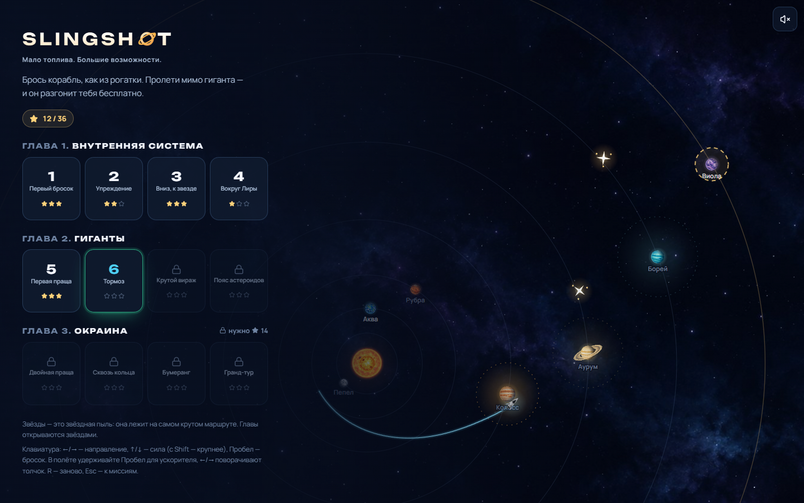
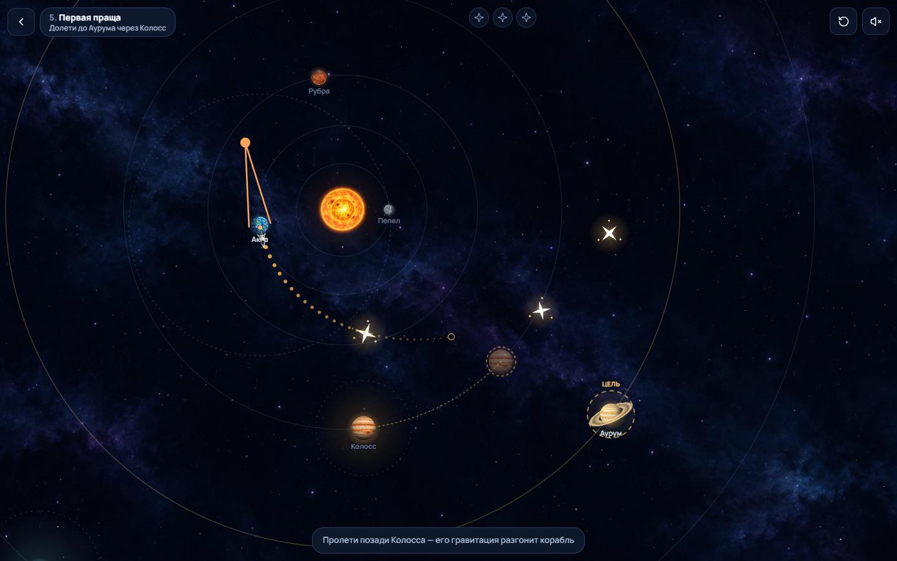
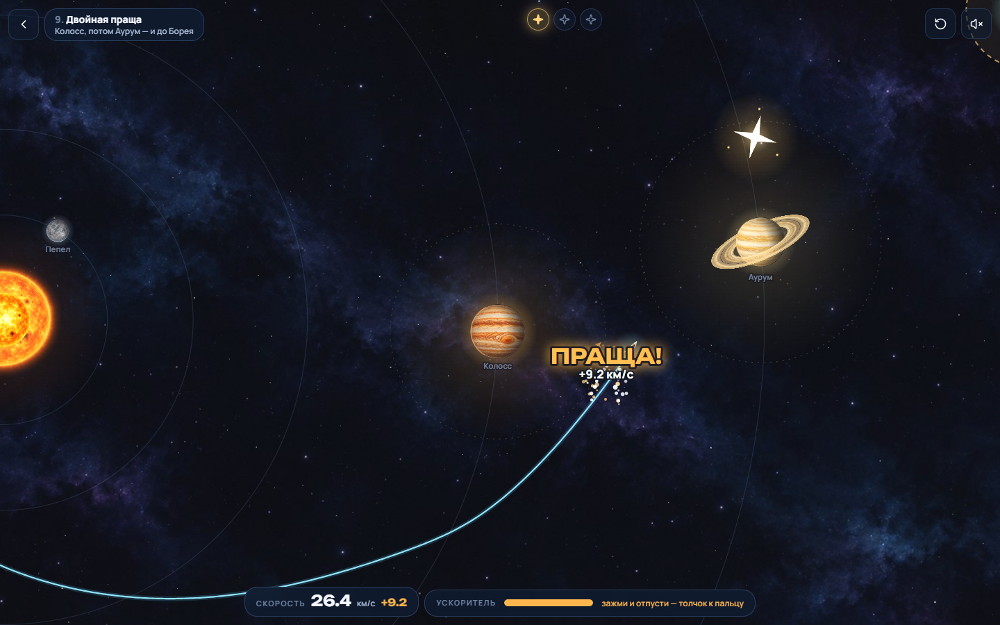
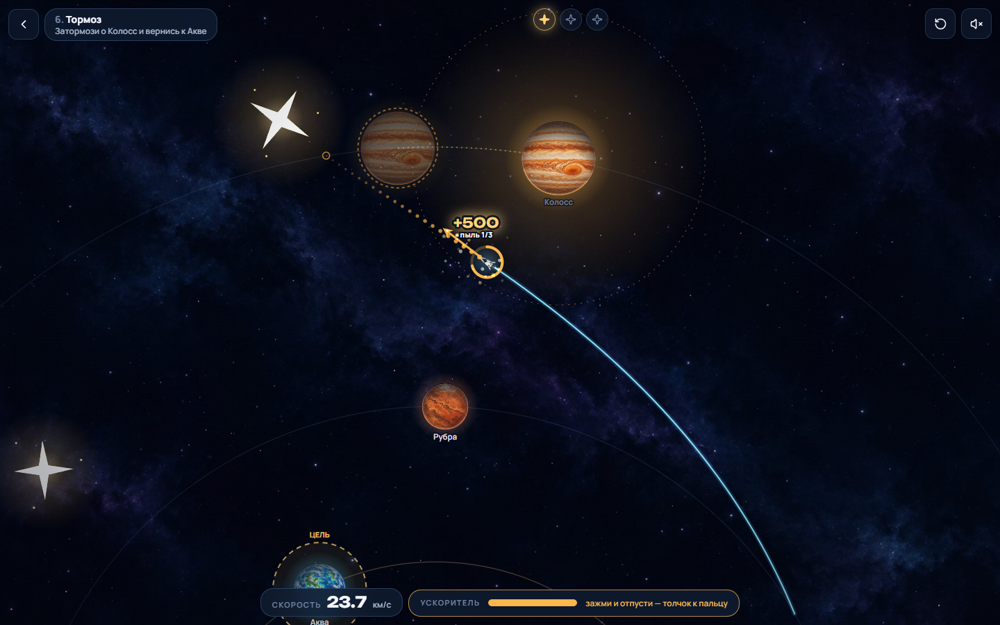
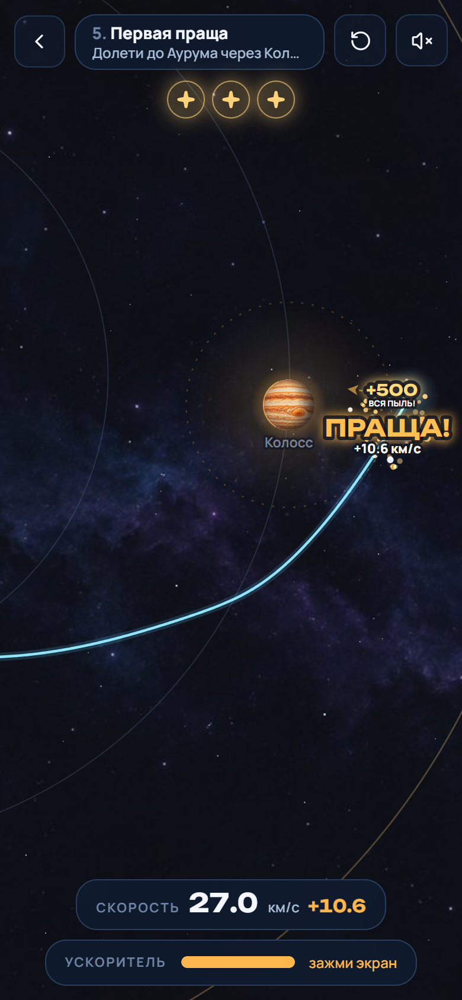

# SLINGSHOT — казуальная ветка

**Брось корабль, как из рогатки. Пролети мимо гиганта — и он разгонит тебя бесплатно.**

Это ветка `casual`: та же система Лира, та же цель (долететь, когда топлива мало, и позволить гравитации сделать
остальное) и та же честная физика, но вместо инженерного планировщика — игра одного жеста. Классическая версия с
редактором манёвров живёт в `master`.

| Меню | Прицел | Праща! |
| --- | --- | --- |
|  |  |  |

| Ускоритель | Результат | Телефон |
| --- | --- | --- |
|  |  |  |

## Запуск

```bash
npm install
npm run dev        # http://localhost:5173
npm run build      # типы + production-сборка в dist/
npm test           # физика, уровни, ускорители, сессия, очки, прогресс (Vitest)
npm run e2e        # сквозные сценарии в браузере (Playwright, десктоп + телефон)
npm run levels     # пересобрать миссии из черновиков (tools/casual-build.ts)
```

`npm run e2e` по умолчанию запускает системный Microsoft Edge (`channel: 'msedge'`); другой канал — через
`PW_CHANNEL` (например, `PW_CHANNEL=chrome`). Требуется Node 20+. Бэкенда нет; прогресс хранится в `localStorage`
(ключ `slingshot:casual`, версия схемы в `src/game/casual/progress.ts`). Адрес с `?all` открывает все миссии.

## Почему старая версия была скучной и что изменилось

Подробно — в [docs/CASUAL_DESIGN.md](docs/CASUAL_DESIGN.md). Коротко:

| было | стало |
| --- | --- |
| планировщик: км/с, углы, даты, редактор | один жест: оттянул и отпустил |
| прогноз показывал весь путь, исход известен до пуска | прогноз — только начало пути; дальше интуиция и «призрак» прошлой попытки |
| полёт — запись, повлиять нельзя | в полёте есть ускоритель: зажми палец — время замедлится, отпусти — толчок |
| награда — таблица в конце | «ПРАЩА! +10,7 км/с», комбо, «ВПРИТИРКУ!», звёздная пыль, тряска, частицы, звук |
| итерация — правка чисел | попытка ~10 секунд, после неудачи прицел возвращается сам |

## Как играть

* **Бросок.** Потяни в любом месте экрана — от корабля растянется резинка. Чем длиннее, тем сильнее; корабль
  полетит в противоположную сторону. Точки показывают **начало** пути, бледные копии планет — где они будут, когда
  точки закончатся (так учишься «упреждению»). Отпусти — полетел.
* **Праща.** Пунктирный круг у гиганта — зона, где он заметно тянет. Влетел — время замедляется, камера
  приближается, и на выходе игра показывает, сколько скорости подарила (или забрала) планета.
* **Ускоритель** (с миссии 2). Зажми палец в полёте: время почти останавливается, стрелка растёт, янтарные точки
  показывают новый путь. Отпусти — толчок в сторону пальца. Короткий тап — слабый толчок, долгое нажатие — полный.
  Бак ограничен: это и есть «мало топлива».
* **Звёзды = звёздная пыль.** В каждой миссии три облачка пыли лежат на эталонном крутом маршруте. Звёзды
  засчитываются, только если корабль долетел до кольца цели. Главы открываются звёздами (6 и 14).
* **Неудача** (врезался, улетел, не долетел) — короткое объяснение, и через полторы секунды снова прицел;
  предыдущая попытка остаётся «призраком» (линия пути и метка, откуда тянул). После трёх неудач появляется
  кнопка-подсказка: золотая метка показывает, куда оттянуть.

Клавиатура: `←`/`→` — направление броска, `↑`/`↓` — сила (с `Shift` — шагом крупнее), `Пробел` — бросок; в полёте
удерживайте `Пробел` — ускоритель по курсу, `←`/`→` поворачивают толчок. `R` — заново, `Esc` — к миссиям, `Enter` —
дальше на экране результата. При `prefers-reduced-motion` тряски нет, вспышки приглушены.

### Очки

| за что | очки |
| --- | --- |
| долетел | 1000 |
| облачко звёздной пыли | 500 |
| праща: каждый км/с, который добавила или забрала планета | 100 × номер пращи подряд (комбо) |
| «Впритирку!» — праща ближе 1,7 радиуса планеты | 500 |
| топливо в запасе | до 600 (пропорционально остатку) |

## Миссии

Три главы по четыре миссии. Каждая вводит одну идею: бросок → упреждение → падение к звезде → облёт звезды →
первая праща → торможение о гиганта → разворот → пояс астероидов → двойная праща → пролёт у колец → бумеранг →
гранд-тур через четыре планеты.

Миссии не расставлены на глаз. `tools/casual-build.ts` пролетает эталонный бросок настоящим интегратором, ставит
планеты туда, где корабль пересечёт их орбиты (с нужной стороны для разгона или торможения), раскладывает пыль по
маршруту, подбирает силу рогатки, бак, длину прогноза и темп, и записывает `src/game/casual/levels.ts`, только если
эталон долетел и собрал всю пыль. Тот же факт проверяет `tests/casual.test.ts` для каждой миссии.

Насколько миссии прощают ошибки (`npx tsx tools/casual-sensitivity.ts [--boost]`): эталонный бросок смещается на
±4° и ±6 % силы (сетка 9×7 = 63 броска), считается, сколько бросков долетает с тремя звёздами — без ускорителя и
если промах можно спасти **одним** толчком:

| миссии | 3★ без ускорителя | 3★ с одним толчком |
| --- | --- | --- |
| 1–4 (внутренняя система) | 59–63 из 63 | 63 из 63 |
| 5 Первая праща, 6 Тормоз | 21 и 38 | 58 и 63 |
| 7–9 (вираж, пояс, двойная праща) | 10–18 | 56–59 |
| 10 Сквозь кольца, 11 Бумеранг, 12 Гранд-тур | 3–4 | 36–50 |

То есть кривая сложности настоящая: первая глава учит жесту, дальше без ускорителя попасть трудно, но почти любой
разумный бросок можно спасти в полёте.

## Физика (без упрощений ради красоты)

Симуляция — в безразмерных единицах с `G = 1`: длина L₀ = 1,5·10⁸ км, масса звезды μ★ = 1, время T₀ ≈ 58,4 суток,
скорость V₀ ≈ 29,7 км/с (`src/game/physics/units.ts`). Планеты движутся по кеплеровым орбитам, корабль — пробная
частица: `dv/dt = −Σ μᵢ (r − rᵢ(t)) / |r − rᵢ(t)|³`.

* Интегратор — адаптивный Дорман–Принс RK5(4) с FSAL, `rtol = 1e-10`; шаг ограничен геометрией (за шаг не больше
  20 % расстояния до любого тела), события (столкновение, цель, вход/выход из сферы действия, уход из системы)
  ищутся внутри шага.
* Старт — метод сопряжённых конических сечений: из центра планеты со скоростью планеты плюс бросок; родная
  планета не тянет корабль, пока он не вышел за радиус отлёта (так нельзя получить энергию даром).
* Максимальный шаг — 0,08 T₀ (около 5 суток): у планет шаг всё равно мельче из-за геометрического ограничения, а в
  пустоте крупный шаг делает прогноз дешёвым для телефона; след между шагами дорисовывается кубической интерполяцией.
* **Ускоритель — мгновенный импульс**: полёт пересчитывается от момента толчка тем же интегратором; одинаковые
  толчки в одинаковые моменты дают побитово одинаковый полёт. Если толчок пришёлся на пролёт у планеты, его энергия
  вычитается из «подарка» планеты: праща считает только гравитацию.
* Выигрыш пращи — изменение гелиоцентрической скорости за счёт планеты, приведённое к расстоянию входа в сферу
  действия (`slingshotGain`).
* Что подкручено для игры (и это видно в каталоге, `src/game/levels/catalog.ts`): гиганты тяжелее, чем в
  классической версии (Колосс μ = 0,022), чтобы праща заметно гнула путь на экране; планеты нарисованы крупнее
  физического радиуса; астероиды — твёрдые, но без гравитации. Замедление времени у планет — только скорость
  проигрывания, на физику не влияет.

## Архитектура

```
src/
  app/                 App: экраны, клавиатура
  game/
    physics/           единицы, орбиты, Дорман–Принс, пропагатор с событиями, интерполяция
    levels/            каталог тел системы Лира, падежи названий
    casual/
      types, levels    формат миссии и 12 сгенерированных миссий
      world, sim       физическая система миссии; Flight — полёт из участков между толчками, сбор пыли, пращи
      session          одна миссия в игре: прицел, живой полёт, темп времени, заряд ускорителя, события
      scoring          очки и звёзды; progress — сохранение, открытие миссий и глав
      audio            звуки, синтезированные WebAudio (файлов нет), вибрация на телефонах
      render/          Canvas 2D: сцена, резинка, точки прогноза, копии планет, пыль, частицы, надписи, тряска
  state/casualStore    Zustand: экран, прогресс, показания HUD, результат
  ui/casual/           Stage (холст, цикл кадра, жесты, реакции на события), меню, HUD, карточка результата
tests/                 Vitest: физика (из master) + казуальный режим
e2e/                   Playwright: первая миссия до победы, неудача с причиной, ускоритель, звук
tools/                 сборщик миссий, анализ «прощения», скриншоты, обработка графики
```

Сессия — чистая логика без DOM: контроллер `Stage` кормит её реальным временем и жестами, а рендерер и звук
читают её состояние и события (`launch`, `dust`, `flybyIn`, `slingshot`, `arrived`, `failed`, `boost`). Поэтому
весь игровой цикл покрыт модульными тестами, включая замедление времени у гиганта и автоматический возврат к прицелу.

## Тесты

`npm test` — 45 тестов: физика из `master` (сохранение энергии и момента, коллизии, детерминизм, интерполяция) и
казуальный режим — каждая из 12 миссий проходится эталоном с тремя звёздами; во второй и третьей главах эталон
действительно использует пращу; ускоритель тратит бак и не больше, детерминирован, не меняет прошлое и не
засчитывается как гравитация; очки складываются из строк; сессия проигрывает эталон с событиями пыли, пращи и
прибытия, замедляет время у гиганта и при зарядке, превращает неудачу в «призрака»; прогресс открывает миссии по
порядку и главы по звёздам. Регрессии из ревью: толчок у родной планеты после возвращения не отключает её
притяжение и поверхность; пролёт, прерванный толчком, считает ближайшее сближение только по реально пролетённой части
(иначе «Впритирку!» засчитывался по пути, которого не было).

`npm run e2e` — на десктопе и телефоне: настоящим жестом мыши пройти первую миссию с тремя звёздами и перейти ко
второй (прогресс переживает перезагрузку); плохой бросок объясняется и прицел возвращается сам; зажатие в полёте
тратит топливо; бросок с клавиатуры; выключенный звук остаётся выключенным.

## Графика и звук

Спрайты планет, звезды, колец, корабля, астероидов и фон сгенерированы через Codex и обработаны
`tools/process_art.py`. Звёздная пыль, резинка, частицы и надписи рисуются кодом. Звуки (бросок, скрип резинки,
заряд, толчок, гул гравитации, аккорд пращи, звон пыли, фанфары, взрыв) синтезируются в WebAudio. Шрифты Manrope и
Unbounded подключены локально.
